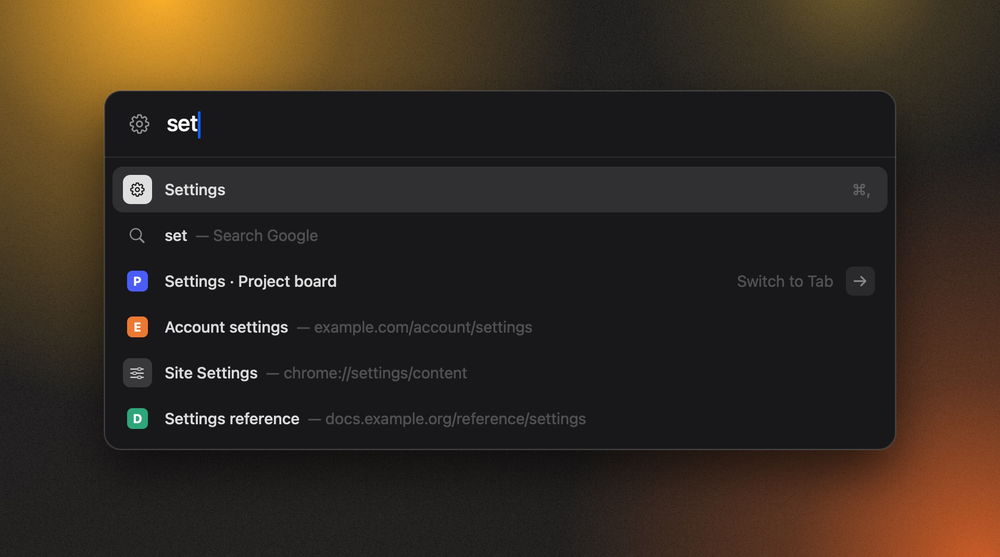
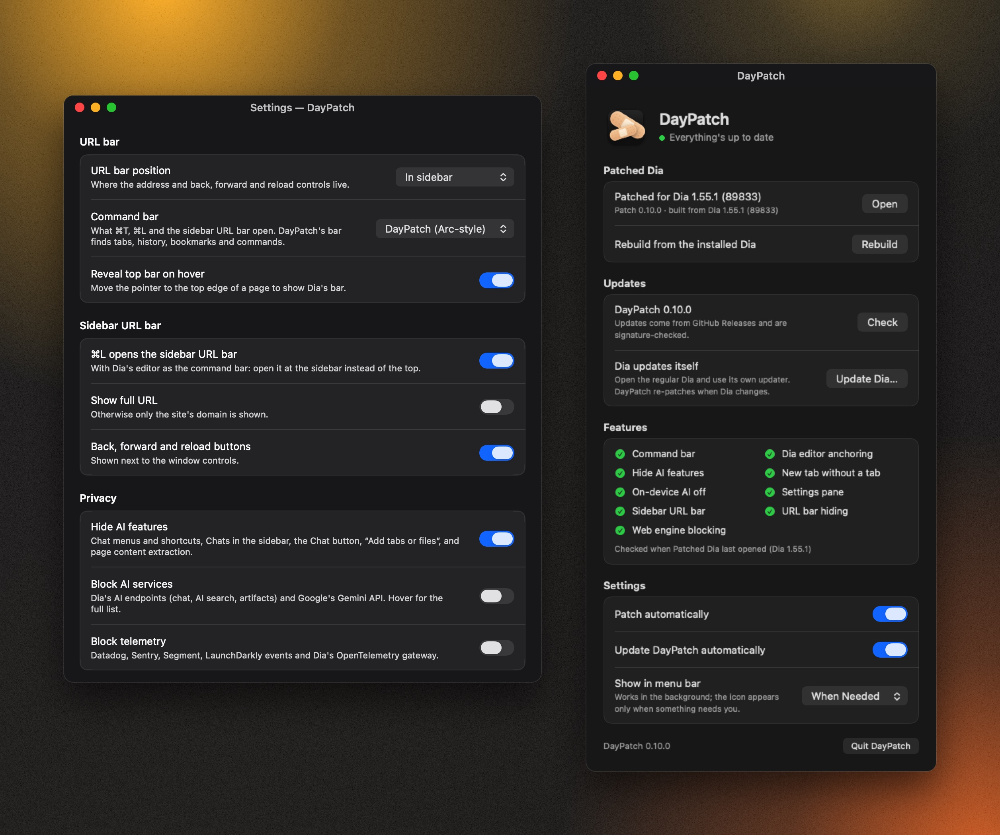

<p align="center">
  
</p>

<h1 align="center">DayPatch</h1>

<p align="center">
  <b>Make <a href="https://www.diabrowser.com">Dia</a> feel like Arc.</b><br>
  Sidebar URL bar · Arc-style command bar · AI out of the way
</p>

<p align="center">
  <a href="https://github.com/TA3/daypatch/actions/workflows/ci.yml"></a>
  <a href="https://github.com/TA3/daypatch/releases/latest"></a>
  <a href="LICENSE"></a>
  
</p>

<p align="center">
  
</p>

> [!TIP]
> **TL;DR** — Install DayPatch, click **Patch**, and your Dia becomes **Dia ✦**: Dia with Arc-style tweaks.
> The original is kept, so you can restore it in one click. Nothing of Dia's is shipped here.

---

## ⚡ Quick start

**You need:** a Mac with Apple silicon, macOS 14+, and [Dia](https://www.diabrowser.com) in Applications.

| Step | Do this |
| :---: | --- |
| **1** | ⬇️ Download **DayPatch.zip** from the [latest release](https://github.com/TA3/daypatch/releases/latest) |
| **2** | 📂 Unzip it and drag **DayPatch.app** into **Applications** |
| **3** | 🚀 Quit Dia, open DayPatch and click **Patch** |

> [!IMPORTANT]
> **First launch only:** right-click **DayPatch.app → Open**. macOS asks because releases aren't notarized by Apple yet.

> [!NOTE]
> **Rather keep your Dia untouched?** Untick **Patch Dia directly** in DayPatch. You then get a separate
> **Dia ✦** in `~/Applications` — use it *instead of* Dia, not both at once (they share one profile).
>
> macOS may ask you to allow DayPatch under **System Settings › Privacy & Security › App Management**.

<details>
<summary>🛠️ Prefer to build it yourself?</summary>

You need Xcode or its command line tools (`xcode-select --install`).

```bash
git clone https://github.com/TA3/daypatch.git
cd daypatch
./companion/build.sh --launch
```
</details>

---

## ✨ Features

### 🧭 Browse like Arc
- 🔗 **URL bar in the sidebar** — with ← → ↻ next to the window buttons
- 🫥 **No top bar** — pages use the full window (optional: hover the top edge to peek)
- ⌘ **Command bar** — `⌘T`, `⌘L`, or click the sidebar URL
  - 🗂️ finds **open tabs** (*Switch to Tab →*), **history**, **bookmarks**
  - ⚙️ runs **Dia commands** and opens **`chrome://` pages** (Flags, Extensions, Passwords…)
  - ✍️ completes sites as you type: `git` → `github.com`
  - 🆕 `⌘T` only makes a tab when you open something
- 🧼 **Clean new tab** — just "Search or enter URL"
- 🎛️ **Settings pane** — everything lives in Dia → Settings → *DayPatch*
- ⌨️ **`⌃⌘U`** — flip between Dia's bar and yours

### 🔒 Privacy
- 🙈 **Hide AI features** — chat menus, Chats, the Chat button, *Chat with this tab*, page extraction
- 🔌 **Local AI agent off** — `agent-server` doesn't start
- 🛡️ **Block AI + telemetry** — *optional, off by default*

### ⚡ Performance
- 🧠 **On-device AI off** — one less ~40 MB process
- 🎚️ **Engine switches** — renderer limit, background networking (optional)
- 🪶 **Light** — about 1 idle wake-up per second

### 🩹 The DayPatch app
- 🔁 **Re-patches automatically** after Dia updates
- ↩️ **Restore Original Dia** — one click, anytime
- ✅ **Feature health** — shows what still works after an update
- 🔐 **Updates itself** — signed releases from this repo
- 🫥 **Hides when it can** — menu bar *Always*, *When Needed*, or *Never*

<p align="center">
  
  <br><sub>DayPatch's pane in Dia → Settings, and the DayPatch app</sub>
</p>

---

## 💡 Good to know

- 🔄 **Updating Dia:** use **Dia ▸ Check for Updates** as usual; DayPatch re-patches after. If that ever fails, **Update Dia…** in DayPatch restores the original to update it, then re-patches.
- 🧩 **If Dia changes something:** that feature quietly switches off; DayPatch's health list tells you which.
- 🔑 **"Dia Safe Storage" prompt:** allow it — Dia ✦ is signed by your Mac, not by Dia.
- 🪪 **Passkeys & Dia-account keychain items** may not work in Dia ✦.
- ⚠️ **Unofficial:** not affiliated with The Browser Company. A modified Dia likely breaks Dia's terms — your call, your risk.

---

<details>
<summary>🔍 How it works</summary>

1. DayPatch keeps an untouched copy of `/Applications/Dia.app` in `~/Library/Application Support/daypatch/` (APFS clone: instant, no extra space), then builds **Dia ✦** from it and swaps it in place. With *Patch Dia directly* off, it builds `~/Applications/Dia ✦.app` instead.
2. It adds `daypatch.dylib` and a weak load command to the executable, so the app loads the patch itself.
3. It re-signs the app ad hoc with the hardened runtime. The only relaxed entitlement is library validation (Dia's frameworks keep their own signature). Dia ✦ rejects `DYLD_INSERT_LIBRARIES`, so nothing else can inject code through the environment.
4. Dia's updater stays on (in place). Updates are checked against Dia's own update key, so they still install; DayPatch sees the stock Dia afterwards and re-patches it.
5. The patch hooks a few of Dia's private classes at runtime. If an update renames one, that feature turns off and Dia behaves normally.

DayPatch's own updates are checked with an ed25519 signature made in CI, using a key that only exists in GitHub's secrets. The release pipeline builds only this repository's code — never Dia.

**Blocking is best effort:** the host list covers what Dia 1.55 contacts. Use LuLu or Little Snitch if you need certainty.
</details>

<details>
<summary>👩‍💻 Development</summary>

```bash
./tests/run.sh                 # tests that need no Dia (also run by CI)
./build.sh --launch            # build ~/Applications/Dia ✦.app directly, without the DayPatch app
./companion/build.sh --launch  # build and install DayPatch
```

**Release:** bump `VERSION` → commit → `git tag vX.Y.Z && git push --tags`. CI tests, builds, signs and publishes.

**Maintainer setup**
1. `./scripts/make-update-key.sh` creates the update signing key. Commit `companion/update-public-key.txt`, store the private key with the `gh secret set` command it prints, and back it up.
2. Optional notarization: add `APPLE_CERTIFICATE_P12`, `APPLE_CERTIFICATE_PASSWORD`, `APPLE_ID`, `APPLE_APP_PASSWORD`, `APPLE_TEAM_ID` secrets (paid Apple Developer account).

**Dev tools** in `tools/` run inside a separate test copy signed with `tools/entitlements-dev.plist` (which allows `DYLD_INSERT_LIBRARIES` — never used for Dia ✦):

```bash
cp -cR /Applications/Dia.app build/DiaTest.app
codesign -f -s - --options runtime --entitlements tools/entitlements-dev.plist build/DiaTest.app
open -n --env DYLD_INSERT_LIBRARIES=/path/to/daypatch.dylib:/path/to/tool.dylib build/DiaTest.app
```
</details>

<details>
<summary>🗂️ Project layout</summary>

| Path | What |
| --- | --- |
| `src/` | The patch: sidebar, top bar, command bar, Settings pane, privacy, performance, health |
| `companion/Sources/` | DayPatch: patch engine, window, menu bar, background job, self-updater, icon |
| `tools/insert-dylib.c` | Adds the weak load command to Dia's executable |
| `tools/update-key.swift`, `scripts/make-update-key.sh` | Update signing keys; sign and verify releases |
| `tools/*.m` | Dev probes and self-tests |
| `tools/screenshots/` | Renders the README screenshots from the real UI code, with demo content |
| `tests/run.sh` | Tests that need no Dia |
| `.github/workflows/` | CI and release automation |
</details>

---

<p align="center">
  <a href="LICENSE">MIT</a> © 2026 The daypatch contributors · Dia is a trademark of The Browser Company; this project isn't affiliated with it.
</p>
